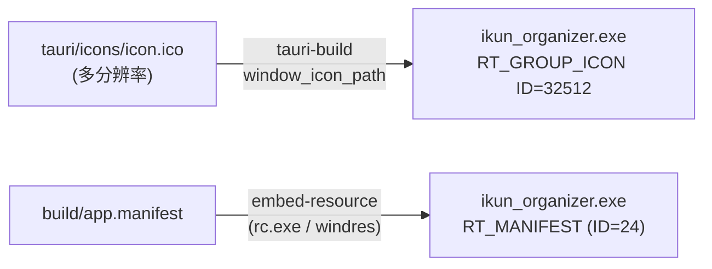

# 应用图标规范（Application Icon Specification）

## 概述

应用图标唯一来源为 `tauri/icons/icon.ico`（项目根目录不再保留 logo.ico 副本）。
编译期由 **tauri-build** 将其嵌入可执行文件（RT_GROUP_ICON，资源 ID=32512）；
运行期由 `app_icon.rs` 从 exe 资源加载，供托盘/右键菜单/窗口标题栏使用。

## icon.ico 文件要求

| 属性 | 要求 |
|------|------|
| **位置** | `tauri/icons/icon.ico`（同时被 `tauri.conf.json` 的 `bundle.icon` 与 build.rs 的 `window_icon_path` 引用） |
| **格式** | Windows ICO（包含多个嵌入尺寸） |
| **必需尺寸** | 16×16, 32×32, 48×48, 64×64, 128×128, 256×256 |
| **色彩深度** | 32-bit RGBA（支持透明通道） |
| **源图建议** | ≥ 512×512 的 PNG，用于生成各尺寸缩放 |
| **Git 追踪** | 必须提交到仓库 |

### 为什么需要多分辨率

Windows 在不同场景请求不同尺寸的图标：

| 场景 | 请求尺寸 | 说明 |
|------|---------|------|
| 系统托盘 | 16×16 | 任务栏通知区域 |
| 窗口标题栏 | 16×16 / 32×32 | 小图标和大图标 |
| 右键菜单 | 16×16 | 菜单项图标 |
| 资源管理器 | 32×32 / 48×48 | 文件图标视图 |
| Alt+Tab 切换 | 32×32 / 48×48 | 窗口切换器 |
| 高 DPI (150%) | 24×24 / 48×48 | 缩放后的实际像素 |
| 高 DPI (200%) | 32×32 / 64×64 | 缩放后的实际像素 |

如果 ICO 只包含单一尺寸，Windows 会做 bitmap-stretch 缩放，导致图标模糊或像素化。

## 编译期嵌入流程



### build/build.rs 行为

1. **tauri-build**：`WindowsAttributes::new_without_app_manifest().window_icon_path("tauri/icons/icon.ico")`
   嵌入应用图标（ID=32512），并关闭 tauri 默认 manifest，避免与本项目的 DPI manifest 重复。
2. **embed-resource**：生成的 `.rc` **只含 manifest**（`1 24 "app.manifest"`），不再另行嵌入 ICON 资源。
   资源编译器发现机制：MSVC 走 PATH 的 `rc.exe` → Windows SDK 注册表（KitsRoot10）→ vswhom；
   GNU 走 `windres`（含交叉前缀与 llvm-windres）。
3. manifest 嵌入失败时仅输出 `cargo:warning`（exe 将缺少 DPI manifest），不中断构建。

> **历史教训（勿回退）**：曾经同一 `.ico` 被 build.rs（ID=1）与 tauri-build（ID=32512）各嵌入一次，
> 两份资源拆出的 RT_ICON 子图像 ID 都从 1 开始，MSVC 的 cvtres 报 CVT1100 duplicate resource
> （GNU ld 容忍重复所以长期未暴露）。现方案为单一嵌入点（tauri-build）。
> 另：旧版 build.rs 只在 PATH 找 windres/rc.exe，MSVC 机 `rc.exe` 不在 PATH 导致“家里电脑托盘无图标”，
> 现统一用 embed-resource 的注册表/vswhom 探测。

## 运行期加载（app_icon.rs）

### 对外接口

- `get_tray_icon()` → HICON（系统托盘，24×24）
- `get_menu_bitmap()` → HBITMAP（右键菜单，16×16）
- `diagnose_icon_availability()` → 启动时诊断图标嵌入状态

### 加载机制

1. `GetModuleHandleW(NULL)` 获取当前进程模块句柄
2. `LoadImageW(hinstance, MAKEINTRESOURCE(id), IMAGE_ICON, size, size, 0)` 按尺寸加载
3. **回退链**：ID=1（历史遗留位，当前构建不再嵌入）→ ID=32512（现行唯一来源）→ 调用方系统默认图标
4. 首次加载后缓存，后续调用直接返回缓存

### 使用图标的位置

| 文件 | 函数 | 用途 |
|------|------|------|
| `sys_tray.rs` | `add_tray_icon()` | 系统托盘图标 |
| `shell_menu.rs` | 菜单构建 | 右键菜单项图标（`get_menu_bitmap()`） |
| `shell_menu.rs` | `setup_desktop_registry()` | 桌面右键菜单注册表项（图标路径指向 exe） |
| `grid_window.rs` | `ensure_class_registered()` | 分类框窗口标题栏图标 |

## 更换图标流程

1. 用源图（≥512×512 PNG）重新生成 ICO 覆盖 `tauri/icons/icon.ico`（生成方法见下）
2. `cargo clean -p ikun_organizer` 后重新构建即可（build.rs 已声明 rerun-if-changed；
   tauri-build 也会跟踪 bundle.icon 列表变化）

## 生成多分辨率 ICO

### 使用 Python + Pillow

```python
from PIL import Image

img = Image.open("source.png").convert("RGBA")
sizes = [16, 32, 48, 64, 128, 256]
imgs = [img.resize((s, s), Image.LANCZOS) for s in sizes]
imgs[-1].save("tauri/icons/icon.ico", format="ICO",
              sizes=[(s, s) for s in sizes],
              append_images=imgs[:-1])
```

### 使用 ImageMagick

```bash
magick convert source.png -define icon:auto-resize=16,32,48,64,128,256 tauri/icons/icon.ico
```

## 发行版图标保障

图标在**编译期**嵌入 `.exe`，且 NSIS/MSI 安装包图标同样取自
`tauri.conf.json` 的 `bundle.icon`（同一个 icon.ico），发行版不依赖任何散落的图标文件。

---

*文件位置*: `.trellis/spec/backend/icon-specification.md`
