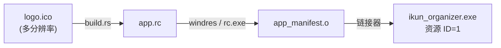

# 应用图标规范（Application Icon Specification）

## 概述

应用图标 `logo.ico` 是项目的唯一品牌标识，在编译时通过 `build.rs` 嵌入到可执行文件的 Windows 资源中（资源 ID=1），运行时通过 `app_icon.rs` 加载使用。

## logo.ico 文件要求

| 属性 | 要求 |
|------|------|
| **位置** | 项目根目录 `logo.ico` |
| **格式** | Windows ICO（包含多个嵌入尺寸） |
| **必需尺寸** | 16×16, 32×32, 48×48, 64×64, 128×128, 256×256 |
| **色彩深度** | 32-bit RGBA（支持透明通道） |
| **源图建议** | ≥ 512×512 的 PNG，用于生成各尺寸缩放 |
| **Git 追踪** | 必须提交到仓库（`git add logo.ico`） |

### 为什么需要多分辨率

Windows 在不同场景请求不同尺寸的图标：

| 场景 | 请求尺寸 | 说明 |
|------|---------|------|
| 系统托盘 | 16×16 | 任务栏通知区域 |
| 窗口标题栏 | 16×16 / 32×32 | 小图标和大图标 |
| 右键菜单 | 16×16 | 菜单项图标 |
| 资源管理器 | 32×32 / 48×48 | 文件图标视图 |
| Alt+Tab 切换 | 32×32 / 48×48 | 窗口切换器 |
| 高 DPI (150%) | 24×24 / 48×48 | 缩放后的实际像素 |
| 高 DPI (200%) | 32×32 / 64×64 | 缩放后的实际像素 |

如果 ICO 只包含单一尺寸，Windows 会做 bitmap-stretch 缩放，导致图标模糊或像素化。

## 编译时嵌入流程



### build.rs 行为

1. 使用 `CARGO_MANIFEST_DIR` 定位 `logo.ico`（比 cwd 更稳健）
2. 生成 `.rc` 文件，引用 `1 ICON "绝对路径/logo.ico"`
3. 依次尝试 `windres`（MinGW）→ `rc.exe` + `cvtres.exe`（MSVC）→ 直接链接 `.res`
4. **如果所有资源编译工具都不可用，`panic!` 中断编译**（防止产出无图标的 .exe）
5. 编译成功时输出 `cargo:warning=嵌入应用图标: <路径>`

### 编译环境要求

编译机器**必须**具备以下任一资源编译工具：

- **MinGW-w64**：提供 `windres`（推荐，安装 Rust 时通常自带）
- **Visual Studio Build Tools / Windows SDK**：提供 `rc.exe` + `cvtres.exe`

## 运行时加载流程

### app_icon.rs 模块

- `get_tray_icon()` → 返回 HICON（系统托盘使用）
- `get_menu_bitmap()` → 返回 HBITMAP（右键菜单使用）
- `diagnose_icon_availability()` → 启动时诊断图标嵌入状态

### 加载机制

1. `GetModuleHandleW(NULL)` 获取当前进程模块句柄
2. `LoadIconW(hinstance, MAKEINTRESOURCE(1))` 从嵌入资源加载图标
3. 首次加载后缓存到 `CACHED_ICON`，后续调用直接返回缓存

### 使用图标的代码位置

| 文件 | 函数 | 用途 |
|------|------|------|
| `sys_tray.rs` | `add_tray_icon()` | 系统托盘图标 |
| `shell_menu.rs` | 菜单构建 | 右键菜单项图标（通过 `get_menu_bitmap()`） |
| `shell_menu.rs` | `setup_desktop_registry()` | 桌面右键菜单注册表项（图标路径指向 exe） |
| `grid_window.rs` | `ensure_class_registered()` | 分类框窗口标题栏图标 |

## 更换图标流程

1. 替换项目根目录的 `logo.ico` 文件
2. 执行 `cargo clean`（确保清除旧的编译缓存）
3. 执行 `cargo build`（触发 `build.rs` 重新编译图标资源）
4. `build.rs` 中的 `cargo:rerun-if-changed=logo.ico` 也会自动触发增量重编译

## 生成多分辨率 ICO 的方法

### 使用 Python + Pillow

```python
from PIL import Image

img = Image.open("source.png").convert("RGBA")
sizes = [16, 32, 48, 64, 128, 256]
imgs = [img.resize((s, s), Image.LANCZOS) for s in sizes]
imgs[-1].save("logo.ico", format="ICO",
              sizes=[(s, s) for s in sizes],
              append_images=imgs[:-1])
```

### 使用 ImageMagick

```bash
magick convert source.png -define icon:auto-resize=16,32,48,64,128,256 logo.ico
```

## 发行版图标保障

由于图标在**编译时**嵌入到 `.exe`，发行版在任何 Windows 机器上都能正确显示图标，不依赖 `logo.ico` 源文件。只需确保编译环境有资源编译工具即可。

---

*文件位置*: `.trellis/spec/backend/icon-specification.md`
